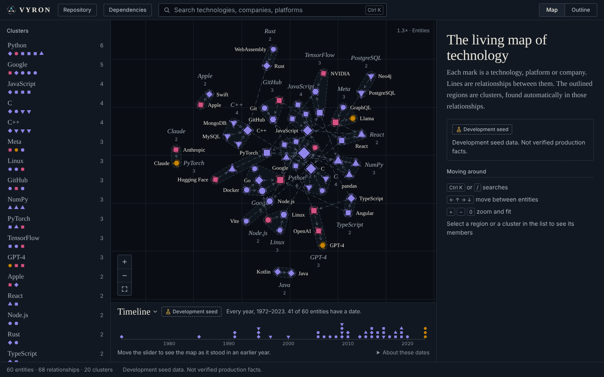
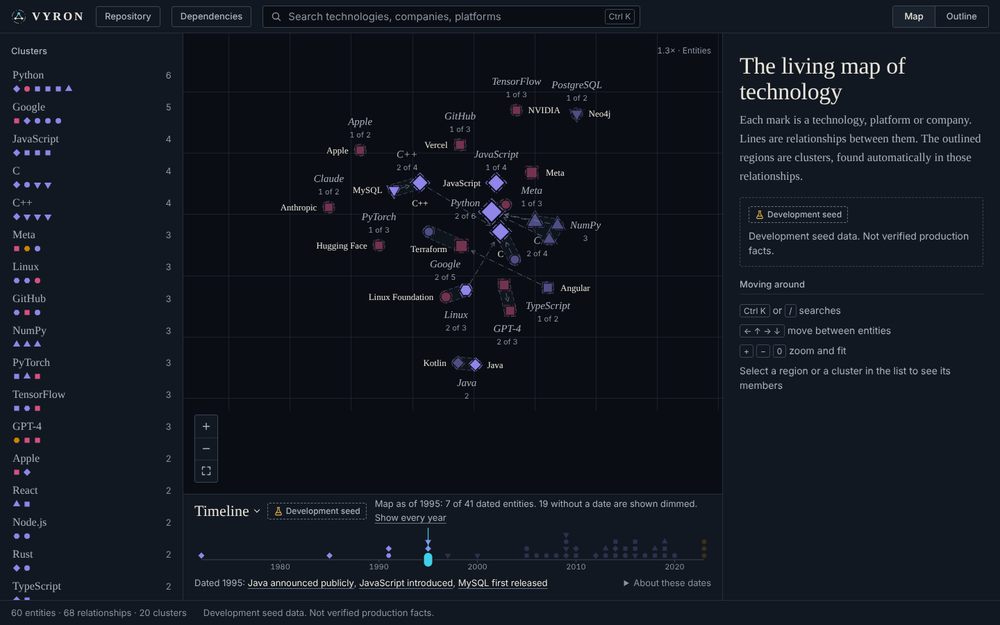
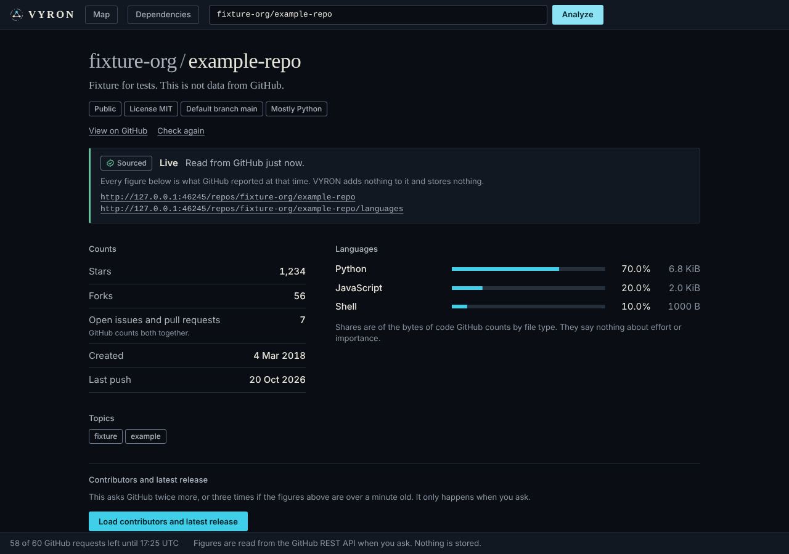
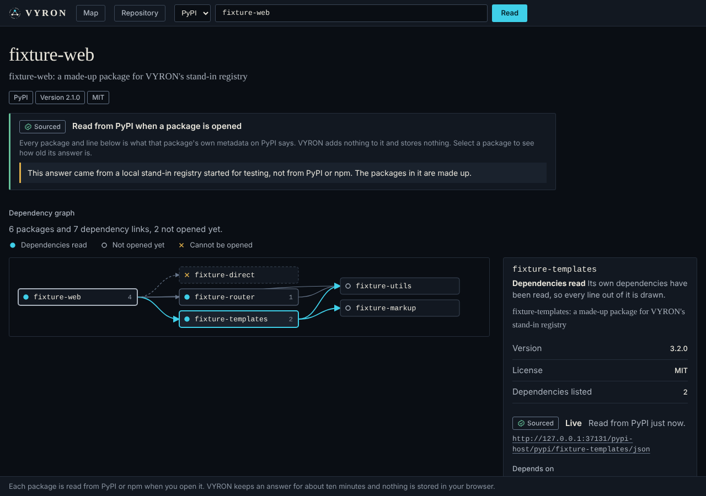

# The browser prototype of the map

Last updated: 2026-11-19. This is the first thing in VYRON that can be opened in a browser. It is a
**prototype**, not the Next.js application in [FRONTEND.md](FRONTEND.md): plain HTML, one stylesheet and
TypeScript compiled by `tsc` alone, no packages, no bundler. It exists so the map can be looked at and
reviewed while package registries are unreachable. Its **map page** draws the 60 development-seed entities,
their 68 relationships and the 20 clusters the API detects, with a timeline strip under the map that shows the map as
it stood in a chosen year, and nothing else. Its **repository page**
(`/repository.html`, described below) shows one public GitHub repository, read when asked. Its **dependencies page**
(`/dependencies.html`, described below) shows what one PyPI or npm package says it depends on, read when asked, and
grows into a graph one package at a time. Those two pages are the only places it shows data that is not seed data.
It is not production ready.



## Run it

```bash
python3 scripts/build_prototype.py        # needs only tsc on PATH; writes apps/web/prototype/dist/js
python3 apps/web/prototype/serve.py       # http://127.0.0.1:8080/   (--port 0 picks a free port)
```

The map is at `/`, the repository page at `/repository.html`, the dependencies page at `/dependencies.html`. Flags:
`--no-github` (the repository page then says GitHub is off), `--no-registries` (the dependencies page then says
PyPI and npm are off), `--allow-token-on-network` (see [GITHUB.md](GITHUB.md): a `GITHUB_TOKEN` is refused on any
address but loopback without it), `--port`, `--no-rate-limit`.

`serve.py` is a development server (standard library, binds to 127.0.0.1). It serves the pages and the real
API (`vyron_api`, seed graph, real rate limiter, live GitHub unless `--no-github`, live PyPI and npm unless
`--no-registries`) from **one origin**, so the
pages need no CORS and no configuration. It answers only to the Host names `localhost`, `127.0.0.1` and `::1`
while bound to loopback, so a web page on another site cannot reach it through DNS rebinding. `--no-rate-limit` exists for automated runs that reload the page many times; leave it off
otherwise. If `dist/` is missing the server says how to build it and exits.

## What it shows

- **Entities** as marks: colour is one of four data groups, shape is the kind (8 shapes), size is
  importance (PageRank from the API when every entity has a score, otherwise connection count, and the
  details panel says which).
- **Relationships** as arrowed lines. Every line is drawn with the provenance dash style from the design
  tokens; all 68 are `seed`, so all are the dash-dot "working" style, and the key in the rail says so.
  A line is never drawn solid unless it is verified, and no solid line exists yet.
- **Clusters** as named territories: dashed outlines (the "derived" style, because the API computes them
  from the relationships) around their members, named after the most central member. Zoomed out, the map
  shows only territories, counts and the number of relationships between them.
- **Details** for a selected entity or cluster: cluster, centrality, connections written as sentences
  ("Python is used by PyTorch"), dated events from the timeline endpoint, and a plain statement that seed
  data has no sources. Connections are links; following one moves the selection.
- **Search** (Ctrl or Cmd + K, or `/`): the API's fuzzy search, with matches lit on the map.
- **Outline**: the same data as text, grouped by kind. It is the non-visual alternative to the map, not an
  afterthought, and works at every window size.
- **Layers** (rail): clusters, kind filters grouped by data group, and the line-style key. On a phone the rail
  also holds the link to the repository page, which the top bar has no room for.
- **Timeline strip** (under the map, map view only): see the next section.

The page's address records the selection (`?focus=<entity id>`), the view (`?view=outline`) and the year
(`?year=1995`). Back and forward move through selections. A parameter that cannot be used is reported on the page and removed from
the address; an id that is not on the map says so.

## The timeline strip



A strip under the map draws one mark per dated entity (same shape and colour as on the map) along a year axis, with a
slider over it. Moving the slider shows **the map as of that year**:

- An entity is **dated by its earliest event on the timeline**, and the notes under the strip say so. Entities
  whose earliest event is after the chosen year are left out of the map: their marks, their lines, and their share
  of a region's count (a region then reads "2 of 6"). Positions never change, so the map keeps its shape while
  the year moves.
- Entities with **no event** have no date and so cannot be placed in time. They **stay on the map in every year,
  dimmed** while a year is chosen, and the status line says how many ("19 without a date are shown dimmed"), so a
  company with no dated event is never mistaken for one that existed in 1995.
- Forecasts (events flagged as predictions) are never placed on the axis. Events that name an entity that is not on
  the map, or whose date cannot be read as a year from 1900 to 2200, are left out too. The notes count what was left
  out and say why; the seed has none, so its notes have no such line.
- The status line says what is shown ("Map as of 1995: 7 of 41 dated entities. 19 without a date are shown dimmed."),
  the line under the chart names what is dated that year (up to 8, then "and N more"), each name selecting that
  entity, and a "Show every year" button puts everything back. **The development seed's dates are seed data**, and the
  strip carries the Development seed badge.
- Choosing an entity that is later than the chosen year (from search, the details or the year line) shows every year
  again and says so in the live region; moving the slider back past the selected entity clears the selection.
- It is one native range input drawn invisibly over the marks, so the keyboard (arrows, Home, End, Page keys), touch
  and screen readers all use the browser's own slider, with the year read out in words (the run drives it with Home
  and the arrow keys; the other keys are the browser's). The strip folds
  (`aria-expanded`); it opens unfolded on a window at least 768 px wide and 700 px tall and folded on a phone, and it
  is `inert` while the details sheet covers it.
- The year in an address that the dates cannot show is **moved to the nearest year that can be shown and the page
  says so**: before the first date it starts at the first date, after the last it shows every year. If the timeline
  cannot be read the map works as before, the strip says "The map is not filtered by year until the dates load" and
  offers **Try again**.

## The repository page



Paste `owner/name` or any GitHub link (a link into a folder, issue or commit reads the repository it belongs to
and says so). VYRON asks GitHub for the repository and its languages through the same-origin API and shows:

- **Where it came from**: a provenance badge, "Live" (read just now), "Confirmed" (checked, nothing changed) or
  "Stale" (GitHub could not be reached, so an older copy is shown, in the warning colour), how long ago, and
  the exact GitHub API addresses read, as links. The age keeps moving while the page is open and is not read
  out again by a screen reader each time.
- **What GitHub reported**: the name, description, whether it is archived or a fork, license, default
  branch, primary language, topics, counts (stars, forks, "open issues and pull requests", because GitHub
  counts them together), created and last-push dates, and a language table with bars, percents and sizes.
  The note under the table says shares are bytes of code by file type and say nothing about effort or importance.
- **What it cannot show**: a private or missing repository (the same answer, said so), a renamed one (says it
  moved), a used-up quota (says how long to wait and that a token raises 60 to 5,000 an hour), a GitHub that
  gave no usable answer (with a request id and Try again), and a server started with `--no-github`.
- **The quota left**, in the footer, turning to the warning colour at one tenth.
- **On request, contributors and the latest release, and a year of commit activity**, each in a section of its own
  that asks GitHub nothing until its button is pressed and says what asking costs first. Commit activity is
  GitHub's weekly counts for the last 52 weeks drawn as 52 thin bars scaled to the busiest week, with the total, the
  busiest week and the weeks with no commits (added up by VYRON, and said to be), a note that the last bar is the
  current week and still filling, and the same figures as a table. GitHub computes these in the background, so the
  first ask may be answered "GitHub is still working this out": the page then offers **Check again** and never checks
  on its own, because every ask, that one included, spends a request from a small quota.

The address (`?repo=owner/name`) is the only state: Back and Forward move between repositories, a copied
address opens straight on its reading, and nothing is stored. Every value is drawn as text, links are only
`http(s)`, and the focus moves to the repository's name (or to the explanation of a failure) so a screen
reader starts there.

**Every screenshot of this page was taken against a local stand-in for GitHub** (`scripts/standin_github.py`),
whose repositories belong to a made-up `fixture-org` and say in their descriptions that they are not from
GitHub. They show how the page behaves and looks, not what GitHub returns. `v20`-`v26`: idle, the report, a
bare repository, a gateway refusal, a phone, a used-up quota, and GitHub switched off. `v27`-`v30`: contributors and the
latest release (a list, a refused list, a rate limit, a phone). `v31`-`v33`: commit activity (still computing, a year drawn
from made-up counts, a phone).

## The dependencies page



Pick PyPI or npm and type a package name, or paste a link to its page on pypi.org or npmjs.com (the link chooses its own
registry; a leading `pypi:` or `npm:` does too). VYRON asks the same-origin API for **that one package**
([REGISTRIES.md](REGISTRIES.md)) and draws what the package's own metadata says it depends on:

- **Where it came from**, said twice. A band above the graph says that every package and line is what that package's own
  metadata on PyPI or npm says, that VYRON adds nothing and stores nothing, and that each answer's age is in the
  package's details. When the answer came from the local stand-in it also says so in words: "a local stand-in registry
  started for testing, not from PyPI or npm. The packages in it are made up." The details of a package that has been read
  carry its own badge: "Live" (read just now, or a copy VYRON kept for under ten minutes, with its real age, which keeps
  moving without being read out again) or "Stale" (the registry could not be reached, so an older copy is shown, in the
  warning colour), the exact registry address read as a link, and a "View on PyPI/npm" link (none for the stand-in).
- **A graph that grows one package at a time.** The root is on the left and what it lists to its right, in columns by the
  longest chain of dependencies from the root, so a package always sits to the right of everything that needs it. A
  line that closes a cycle points back the way the arrows do not go, and is reached from the details and the outline
  rather than the arrow keys. Each package has a word for its state, a border style and a shape, never colour alone:
  **Dependencies read** (its own dependencies have been read, so every line out of it is drawn), **Not opened yet** (it
  has no lines out, *which does not mean it has no dependencies*), and **Cannot be opened** (another package lists it as
  a link, path or alias, which a registry cannot look up by name; the line to it is dashed). Opening a package (click,
  Enter or Space, or the "Read its dependencies" button) reads it with one more request and adds what it lists. Nothing
  is read until it is asked for.
- **What was left out**, under "Declared but not drawn" in the package's details, in words and counts from the API's
  `left_out`: PyPI requirements that only apply under an extra, a Python version or a platform (VYRON does not evaluate
  those conditions), and npm development, peer and optional dependencies. A package that lists none says it lists none.
- **Details** for the selected package: its state and what the state means, its summary, version, license and number of
  dependencies, what it depends on and what needs it (choosing a name selects that package, and reads it if it has not been
  read yet; the requirement is shown when it is plain version syntax, otherwise "given as a link or path"), and, if the last attempt to open it failed, the failure
  and **Try again** inside the details, so the graph does not move. A failure to open one package never removes the
  graph already drawn.
- **A text outline** of the same graph (names, states, who depends on whom) is the non-visual alternative, on every window
  size. A summary line says how many packages and lines are drawn and how many dependencies were not drawn because the
  graph holds at most 200 packages.
- **Release history** (2026-11-19), under the graph, for the selected package. Nothing is asked until the button
  "Show release history for <package>" is pressed; the line above it says what pressing does and that an answer VYRON
  already holds from the last ten minutes is reused. It then draws the dates the registry itself records (see
  [REGISTRIES.md](REGISTRIES.md#the-release-history-route)) as **a strip of marks on a time axis** with year labels, and
  the same releases as **a table**, newest first (the first 100 rows, then "Show all N releases").
  - *What a date is* is said in words every time: on PyPI the earliest upload of a file for that version, on npm the
    registry's publish time; "not necessarily the day its author tagged or announced it". A line says that nothing here
    says whether a package is maintained, safe or worth using.
  - *Marks* are never colour alone: a filled circle is a release, a hollow circle is a **pre-release by its version
    number** (a reading of the number, said as such), a diamond is **yanked** (PyPI: every file of the version) or
    **deprecated** (npm), and a legend with words sits beside the strip. Releases too close to tell apart are packed into up
    to six rows; if the rows run out the marks overlap, **the page counts and says how many**, and the table lists every
    release. The drawing is 64 px per calendar year, between 480 and 1800 px, and scrolls sideways inside its own box.
  - *Keyboard and pointer*: the strip is one tab stop; Left/Right (also Up/Down) move one release, PageUp/PageDown ten,
    Home/End the first and last; the "Earlier" and "Later" buttons do the same (they stay focusable at the ends and say
    they are unavailable). A mark can be clicked or tapped. The selected release is read out in a line under the strip
    ("Version 1.5.1, 3 March 2021, 10:15 UTC. Yanked: …") and in a polite live region.
  - *What was left out* is in words and counts: versions with no usable date, npm versions with a recorded time but no longer
    published, dates before 1991 or in the future, entries that are not versions, and "N earlier releases are not listed,
    because VYRON keeps the newest 2000".
  - *Failures*: a registry with no release dates in its answer says so in fixed words ("PyPI's answer for this package has no
    release list. PyPI documents that list as deprecated, so it may not always be there. The dependencies on this page are
    not affected."); a rate limit, a failed read and an unreachable registry have their own words, and **Try again** keeps
    the graph where it is. A package given as a link, path or alias has no history to read, and says why.
  - Each package's history is kept while the page is open, so choosing another package and coming back does not read it
    again. Nothing is stored beyond the page.

The address (`?package=pypi:flask`) holds the package the graph started from and is the only state: a copied address
opens straight on it (checked), Back and Forward are wired to re-read the address (written, **not exercised in the browser
run**), and nothing is stored. Keyboard: the graph is one tab stop;
arrows move to the nearest package in that direction, Home returns to the root, Enter or Space selects and opens.
Selections and results are announced in a polite live region, and the page has a forced-colours rule set.

**Every screenshot of this page was taken against a local stand-in for PyPI and npm** (`scripts/standin_registry.py`),
whose packages are all named `fixture-*` and say they are made up. They show how the page behaves and looks, not what
the registries return. `v38`-`v47`: idle, a root read, a graph grown by opening a dependency, the outline, a 40-dependency package, a dependency that failed to open, a registry rate limit,
an npm package, a phone, and the registries switched off. `v48`-`v50`: the release history (a package with 23 dated versions,
a 272-release history that is wider than the window with burst marks overlapping, and a phone). **The dates in those
screenshots are made up** like every other fixture here.

## How it is built

```
packages/graph/src   pure geometry, shared with the future renderer: atlas (indexes), layout (force, seeded,
                     deterministic), camera, glyph shapes, hulls, level of detail, label and relationship-phrase
                     placement, keyboard navigation, outline, URL state, timeline (dates per entity, year buckets),
                     dependency-graph (a package graph read one package at a time, layered layout, outline)
apps/web/prototype
  index.html         the map's shell; no inline script, style or handler
  repository.html    the repository page's shell, under the same rules
  dependencies.html  the dependencies page's shell, under the same rules
  prototype.css      layout and SVG styling for both pages, only the generated design tokens (no colour of its own)
  src/data.ts        loads the atlas through the typed client and checks it against the API's own counts
  src/map.ts         the SVG map: layers, camera, input, keyboard, drawing
  src/panels.ts      rail, details, outline, search combobox
  src/time-model.ts  the strip's words (status, year line, notes, clamp notice), pure and unit-tested
  src/time-strip.ts  the strip: marks, slider, fold, retry
  src/main.ts        wiring: state, address, history, announcements
  src/repository.ts  the repository page: form, states, report, quota, address
  src/repository-model.ts  its pure logic (cache wording, failures, languages, figures, address), unit-tested
  src/dependencies.ts      the dependencies page: form, states, the graph drawn as SVG, details, outline, address
  src/dependencies-model.ts its pure logic (input and links, cache and failure wording, state words, address), unit-tested
  serve.py           the one-origin development server
```

Decisions worth knowing:

- **Registry-free**: `tsc` compiles with `rewriteRelativeImportExtensions`, so the browser loads native ES
  modules that mirror the repository tree. No import map, no bundler.
- **No string markup**: elements are built from text with `dom.ts`, which refuses `style` and `on*`
  attributes. `serve.py` sends `default-src 'self'` with no `unsafe-inline`; Chromium reported no violation.
- **Data is checked, not assumed.** `loadAtlas` reads `graph/overview`, every page of `entities`, then one
  three-hop neighbourhood per not-yet-covered entity (at most 20 such calls; the seed graph needs far fewer,
  and the 60 a minute graph limit is never close), and compares what it holds with the counts the API reported. If anything is missing the footer says so.
- **A small graph is read whole, if the window has room.** Up to 60 entities the map opens at entity level and
  names every entity that finds room, but only where the shorter side of the map is at least 80 px per square root
  of the entity count (about 620 px for 60). A phone is not, so it opens at the clusters, and tapping a region zooms
  to its entities with the region framed above the details sheet. Larger graphs open at cluster level and spend a
  label budget by importance.
- **Overlay layouts re-frame.** Where the details panel covers the map (under 1100 px wide) a tap centres the
  selection in the part left visible, and when the panel changes size the selection is centred again.
- **Labels can be forced but not buried.** A name that must be drawn (the selection and what it connects to) and has
  no free side takes the side where it covers least, counting text outside the visible area four times as heavy.
  Region names try above, below, right and left, and are kept inside the map. Relationship counts between regions
  show only from 2.
- **Date filters hide, they do not move.** The strip's filter uses the map's existing filter, so positions are the
  layout's and do not change with the year.
- **Labels never sit on marks or on each other.** Each name tries right, left, above and below its mark and
  stays inside the visible area (not under the details panel). Region names go above or below their region.
  A relationship phrase for the selected entity is placed beside its line, or left out when there is no room;
  the connection list in the details always has all of them.
- **One API change was needed.** Cluster summaries now carry `member_ids` (at most 300, most central first),
  because drawing a territory needs its members. The API tests, [openapi.json](openapi.json) (`ClusterSummary`)
  and the generated TypeScript types were updated together.

## Keyboard and assistive technology

Skip link first; the map is one tab stop with arrow keys moving to the nearest entity in that direction,
Enter or Space selecting, `+` `-` `0` zooming and fitting, Escape clearing. Search is an ARIA combobox.
Selections, cluster choices and result counts are announced in a polite live region. The pointer and touch
hit area of a mark is larger than the mark. Motion obeys `prefers-reduced-motion` (the camera jumps).

## What was verified, and how

| Check | Result |
| --- | --- |
| Unit tests for the geometry in `packages/graph` | 217 pass (atlas, camera including the opening zoom for a given window, glyph, hull, layout, level of detail and label placement including forced labels, navigation, outline, URL state, timeline model, 47 for the dependency graph, and 26 for the release strip (placement on a time axis, row packing and a counted overlap when rows run out, year ticks that never run together, the keys that move between releases, dates that cannot be read): adding a package read, columns by longest chain with cycles ignored, a re-read that drops a dependency pruning what only it reached, the 200-package cap, arrow-key stepping, the text outline, node states) |
| Unit tests for the page's own logic (data loading with a fake API, address parsing, formatting, the strip's sentences) | 43 pass for the map (19 of them the strip's wording, 4 reading every page of events); 67 for the repository page (cache and age wording, every failure's message, language shares including "<0.1%", figures, address round trip); 38 for the dependencies page (input and pasted links, cache and failure wording, state words, graph sentences, address); 30 for the release history's wording (what a date means in each registry, notes for a pre-release, yanked or deprecated version, what was left out, the crowding and omitted-older sentences, the table's rows and its cut at 100, the "no release dates" failure) |
| Data loading against the real Python API over a socket | 7 pass: 60 entities, 68 relationships, 20 clusters, complete, deterministic layout |
| Server and page contract (`tests/test_prototype.py`) | 67 pass, over all three pages, including a check that no rule inside a media query is silenced by a later plain rule for the same selector (two phone rules and three forced-colours rules were lost that way and found by the Chromium run): strict CSP, no path traversal or symlink escape, only `.js` from the build, API and static on one origin, no inline script or style, every id the script looks up exists, every design token used is defined, every class a page or script uses is styled, the repository section of the stylesheet redefines no class the map already styles, no markup built from strings, the repository and dependencies scripts name no host and so cannot reach GitHub, PyPI or npm themselves |
| `tsc --strict` over the prototype | clean |
| Chromium run (`scripts/verify_prototype_browser.py`) | 462 checks pass. **Map, 134** (39 on the timeline strip), at 1440x900, 900x800, 390x844 and 375x667 (touch): search, selection, cluster, zoom levels, outline, keyboard, Back/Forward, reduced motion, API failure and recovery, bad addresses, no horizontal overflow, nothing outside the stage, no entity name on another entity's mark, no console error or CSP violation; on a phone the opening level, the two-row bar, the Repository link in the rail, tapping a region and then a mark with the sheet open, the folded strip becoming `inert` under the sheet, and choosing a year; on the strip the seed badge, one mark per dated entity, the slider's range, a year chosen by keyboard hiding exactly the later entities and dimming exactly the undated ones, the status and year-line sentences, the address and reloading, selecting from the year line, the selection cleared or the year widened as described above, folding, the outline view, years outside the range, and the timeline failing and being retried. **Repository page, 138** (39 on the opt-in contributors and latest-release section, 34 on the opt-in commit-activity section, the rest on the reading itself), against the GitHub stand-in at 1280x900 and 375x740, in forced-colours mode, and against a server with GitHub off: idle, a healthy read, a second look not reaching GitHub, a link into the repository, a bare repository, Back, Enter, private, missing, moved, gateway, broken and garbled answers, a hiccup that is retried, bad input, a hostile address value shown as text, a used-up quota not spent further, no horizontal overflow, only the browser's own status messages in the console when failures are the point. **Dependencies page, 190** (114 on the graph and 76 on the release history), against the registry stand-in at 1280x900, 375x667 and 320x568, and against a server with registries off: idle with its examples, a healthy PyPI read with the stand-in note and the age, a dependency opened by click and by keyboard, a graph grown across several levels, a package listed by two others, a cycle drawn once with both lines, a 40-dependency package, a dependency a registry cannot look up by name (no read button, a dashed line), left-out requirements counted in words, the text outline, a missing package, rate limit, 500 and garbled answer each with its own words and focus, an expansion that fails inside the details and is retried without moving the graph, an npm scoped package, a pasted npmjs.com link, an address restoring the starting package alone, a second look not reaching the registry, no horizontal overflow at 320 px, controls at least 24 px tall, no console error or CSP violation. **The release history**: nothing asked for until the button is pressed, one request to the releases route and none more when the same package is opened again or another is chosen and returned to, a mark per release with the right shape and a name that carries version, day and notes, arrow, Home, End and Page keys, the two buttons including at both ends, clicking and tapping a mark, the readout line, the table newest first with its cut at 100 and "Show all", the date-meaning sentence, an npm package, a 272-release history with overlapping marks said in words, a package with no dates, a 429 and a 500 each with its own words and **Try again**, a link-only dependency with no history to read, no horizontal overflow of the page at 375 px and 320 px, and every control at least 24 px tall (the marks themselves are smaller; the arrow keys and the two buttons of at least 32 px do the same job) |
| Mutation spot-checks for the release history (by hand, 2026-11-19, on a scratch copy, each after a control run) | 18 of 18 made a test fail, 7 of them on the page's own strip logic and wording (no row packing, overlaps not counted, End going to Home, a yanked version drawn as a circle, a pre-release not noted, the date meaning claiming the tag day, omitted and crowded releases unsaid) and 11 on the API ([REGISTRIES.md](REGISTRIES.md)). Not a committed script |
| Mutation spot-checks for the dependencies feature (by hand, 2026-11-14, on a scratch copy, each after a control run) | 11 of 11 made a test fail: a stale read worded as live; a stand-in not recognised; a rate limit not retryable; a registry host named in the page script; a class losing every CSS rule; the page no longer served; a stand-in answer carrying a registry page; and four on the API reader and route (see [REGISTRIES.md](REGISTRIES.md)). Two attempts first looked like survivors for the wrong reasons (a Python bytecode cache that ignored a same-length edit; a CSS rename that left other rules for the class), and were redone properly. Not a committed script |
| Mutation spot-checks (run by hand on 2026-10-19, each after a control run on unmodified code) | 8 of 8 made a test fail: path guard removed; `unsafe-inline` added to the script policy; any file type served from the build; labels allowed to overlap labels; labels allowed on marks; name placement ignoring the visible bounds; relationship phrases allowed to overlap; data always reported complete. Not a committed script, so not repeatable from the repository |

Screenshots from that run are in [prototype/](prototype/): `v01` opening view, `v02` search, `v03` selection
from search, `v04` an entity with its relationships, `v05` a cluster, `v06` the clusters level, `v07`
zoomed in, `v08` outline, `v09` keyboard focus, `v10`-`v12` medium width, `v13`-`v15` phone, `v16` API
failure, `v17` a bad address, `v20`-`v33` the repository page (stand-in fixture data, see above), and `v34`-`v37`
the timeline strip (the map as of 1995, the dates failing to load, a phone with a region selected, a phone with the
strip open), and `v38`-`v50` the dependencies page and its release history (stand-in fixture data, see above).

The checks say what the page does. They do not say it looks right: that was judged by looking at the
screenshots, and a person should look again.

## UNVERIFIED and known limits

- **Scale.** Only 60 entities have ever been drawn, and at 60 the middle of the map is still crowded: on a phone
  the opening view is the clusters, and even there the central regions overlap and a few region names touch (in
  `v36` the names near Python, Google and PyTorch). The SVG renderer has
  not been measured with hundreds or thousands, the layout runs on the main thread and has not been timed above
  60 entities, and the WebGL
  renderer in [FRONTEND.md](FRONTEND.md) does not exist. Do not read the label budget or level-of-detail rules
  as proof of anything at scale; they are unit-tested rules, not measured behaviour.
- **Fonts.** Newsreader and Hanken Grotesk are named in the tokens but not shipped. The screenshots show the
  fallback fonts of the machine that took them, so type will look different elsewhere.
- **One browser, one OS.** Chromium on Linux is the only combination I ran, with touch emulated. Firefox, Safari
  and real phones and tablets were not tried. The project owner reports running the prototype on Windows with
  no console errors and passing tests (a report, not something I saw); that run's one extra skipped test is
  most likely the symlink-escape test, which skips where symlinks cannot be created. The error layout uses
  `:has()`.
- **Assistive technology.** The roles, labels, live regions and focus order are written and checked in the
  DOM. No screen reader and no accessibility checker (axe or similar) has been run. Contrast was computed for
  the tokens; the dimmed state (unrelated marks at 30% opacity, unrelated lines at 16%) was not measured.
- **GitHub.** I have never seen the repository page read the real GitHub. It was built and run against a stand-in
  that serves fixture data written from GitHub's documentation, so it shows the page handles those shapes, not
  that GitHub sends them. The project owner reports (2026-10-26, not witnessed by me) one passing run of
  `scripts/live_github_check.py` against the real GitHub, and using the page on `pallets/flask` with the right
  figures, evidence links and no console error, in a browser that was not named. That is one repository without
  a token; treat everything else on the page as UNVERIFIED against GitHub ([GITHUB.md](GITHUB.md)). The API
  behind the contributors and latest-release section was run against the real GitHub once for the same repository
  (reported 2026-11-02); nobody has reported opening that section in a browser against real data. The commit-activity chart
  was written from two real answers (2026-11-04) but has only been seen drawn from made-up counts, and nobody has reported
  opening that section against real GitHub.
- **Phone with the sheet open.** The map area is small. Pinned names that have no clear spot are drawn on their
  least harmful side, which still can touch another name, and the zoom buttons and the zoom readout sit over the
  map's corners (the readout and the first-visit hint have a solid backing on a phone so they stay readable). The
  strip, unfolded, takes about 40% of a phone's height, which is why it opens folded there.
- **The timeline's dates are seed dates.** The 41 seed events give 41 of 60 entities a date; the other 19 are
  companies and organisations with none. A real timeline needs real dated events (the dependencies page
  now shows package release dates, but they are not on the map), and every claim here about "what existed in 1995" is about the seed, not about history. Dates are
  placed by an entity's earliest event, which is not always its creation.
- **The strip's reading by assistive technology** was not tested with a screen reader: the slider is a native range
  input with a spoken year, and the year line, status line and live region are written and checked in the DOM only.
  Marks on the strip are drawn, not focusable; the slider is the one control.
- **PyPI and npm.** I have never seen the dependencies page show a real PyPI or npm answer. Every screenshot and browser
  check ran against `scripts/standin_registry.py`, which serves fixture data written from the registries' documentation and
  from the shapes reported for flask and express. The API route behind the page was reported passing against the real
  registries on 2026-11-15 (`scripts/capture_registry.py`: flask, requests, numpy, django, express, react, @types/node and
  left-pad read, and a missing name on each registry answered 404; one run, relayed, I did not see it; I checked the express
  figures against npm myself). What that run did not meet is listed in [REGISTRIES.md](REGISTRIES.md): a dependency not
  readable by name, a 429 or 5xx, a stale copy. Until someone has looked at the page with a real package, treat how it
  looks and reads with real data as UNVERIFIED.
- **The dependencies page** was not run in forced-colours mode (its rules are written), not read with a screen reader
  (the graph is an SVG with one tab stop, roving focus and a text outline, checked in the DOM only), and never given a
  graph near its 200-package cap. The layered layout is one pass with rows ordered by neighbours and no further
  crossing minimisation, so a wide graph can cross lines (`v42`).
- **The release history** has never shown a real PyPI or npm answer, and the route behind it has never been run against the
  real registries (the 2026-11-15 capture run was made before it existed; `capture_registry.py` now checks it). Its dates are
  from fixtures written by hand, so **the shape of PyPI's `releases` and npm's `time` as the registries actually send
  them is UNVERIFIED**, and PyPI documents the key it reads as deprecated. It was not run in forced-colours mode (rules are
  written), not read with a screen reader, and Back and Forward are written but were not exercised for it. The marks are
  drawn at 9 px, under the 24 px target size; the arrow keys and two buttons of at least 32 px are the equivalent, and
  whether that is enough for a person using a pointer or a switch has not been tested with anyone. A package with
  thousands of versions has only been tried with 272. The strip is a picture: the table is the record. It is not a
  judgement of a package.
- **Not in the prototype**: other map modes (genome, archaeology), a package or repository on the map,
  dependency analysis of a repository's manifests, the research layer, sign-in, saving anything. There
  is no persistence of any kind.
- **Data.** The map is development seed only, labelled as such everywhere; nothing real has been ingested into
  the graph. The repository page shows live GitHub data when it is run against GitHub, and the dependencies page shows live PyPI
  and npm data when run against them; each says where it came from and how old it is, and keeps none of it.
- **Server.** `serve.py` and its headers are for local development. Production headers, TLS and caching are
  undecided ([DEPLOYMENT.md](DEPLOYMENT.md)). A `GITHUB_TOKEN` on a shared server lets anyone who can reach it
  spend the quota; the server refuses that on a non-loopback address unless told otherwise.
- **Tooling.** The Chromium script needs the Python `playwright` package and a Chromium build. That is
  tooling used here, not a project dependency, and it is not part of `scripts/verify_stdlib.sh`.

## Re-running it all

```bash
scripts/verify_stdlib.sh --strict                 # unit, contract, integration tests; type check; emit
python3 scripts/build_prototype.py
python3 scripts/verify_prototype_browser.py       # needs playwright and Chromium; refreshes docs/prototype/
python3 scripts/standin_github.py --mode prototype  # look at the repository page yourself (fixture data)
python3 scripts/live_github_check.py              # the check against the real GitHub, where it is reachable
python3 scripts/standin_registry.py --mode prototype  # look at the dependencies page yourself (fixture data)
python3 scripts/capture_registry.py --capture captures  # the check against the real PyPI and npm, where reachable
```
